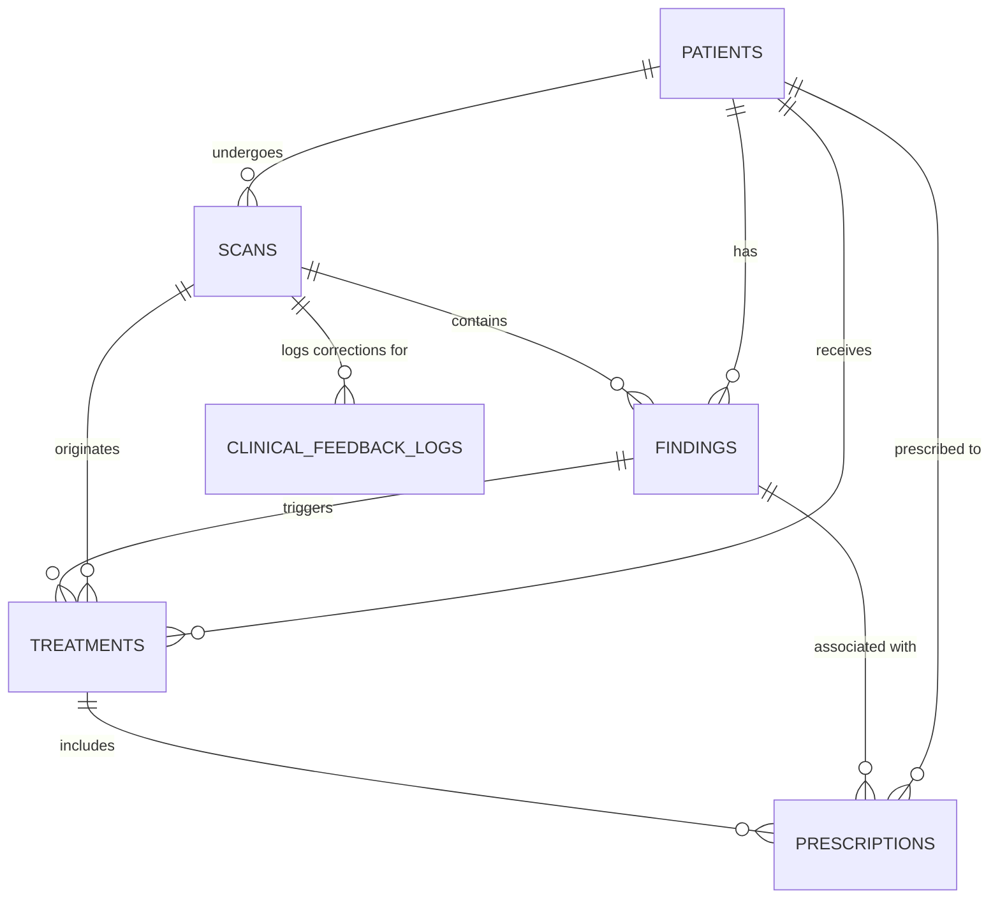

# DentalAI — Database Specification & Schema Guide

This document describes the Supabase PostgreSQL schema. **`supabase/schema.sql` is the executable source of truth**; this file explains it. Any developer altering the database must update both.

---

## 1. Entity Relationship Diagram (ERD)

Deleting a patient cascades to scans, findings, treatments and prescriptions. Deleting a finding sets `treatments.finding_id` / `prescriptions.finding_id` to NULL. `dentist_id` columns reference `auth.users` and are `NULL` until Supabase Auth is wired in (Phase 5).

---

## 2. Table Dictionaries

Columns every table has: `id UUID PK DEFAULT gen_random_uuid()`, `created_at` / `updated_at TIMESTAMPTZ` (except `clinical_feedback_logs`, which has no `updated_at`: it is immutable).

### 2.1 `patients`
Longitudinal clinical data needed for safety checks.

| Column | Type | Constraints | Description |
| :--- | :--- | :--- | :--- |
| `dentist_id` | `UUID` | FK `auth.users`, SET NULL | Treating clinician |
| `first_name`, `last_name` | `VARCHAR(100)` | NOT NULL | Names |
| `date_of_birth` | `DATE` | NOT NULL | Age and pediatric/elderly rules |
| `gender` | `VARCHAR(20)` | NOT NULL, IN (`male`,`female`,`other`) | |
| `phone`, `email`, `address`, `notes` | text | nullable | Contact / free notes |
| `weight_kg` | `NUMERIC(5,2)` | `> 0` | Pediatric weight-based dosing |
| `allergies` | `TEXT[]` | default `{}` | e.g. `{'penicillin'}` |
| `current_medications` | `TEXT[]` | default `{}` | e.g. `{'warfarin'}` |
| `medical_conditions` | `TEXT[]` | default `{}` | e.g. `{'cardiac_endocarditis_risk','gi_ulcer'}` |

The three arrays are free text; the backend matches them against alias tables (see `CLINICAL_GUIDELINES.md` §5.11).

### 2.2 `scans`
| Column | Type | Constraints | Description |
| :--- | :--- | :--- | :--- |
| `patient_id` | `UUID` | NOT NULL, FK `patients` CASCADE | |
| `dentist_id` | `UUID` | FK `auth.users`, SET NULL | |
| `scan_type` | `VARCHAR(50)` | default `panoramic` | |
| `image_url` | `TEXT` | NOT NULL | Supabase Storage URL |
| `storage_path` | `TEXT` | nullable | Path in the `xray-scans` bucket |
| `status` | `VARCHAR(30)` | IN (`uploaded`,`processing`,`analyzed`,`reviewed`,`failed`) | Lifecycle |
| `raw_ml_output` | `JSONB` | default `{}` | Verbatim `dentex_week3` response |
| `ai_report` | `TEXT` | nullable | Model-written report |
| `image_width`, `image_height` | `INT` | nullable | Pixels |
| `notes` | `TEXT` | nullable | |

### 2.3 `findings`
| Column | Type | Constraints | Description |
| :--- | :--- | :--- | :--- |
| `scan_id` | `UUID` | NOT NULL, FK `scans` CASCADE | |
| `patient_id` | `UUID` | NOT NULL, FK `patients` CASCADE | |
| `dentist_id` | `UUID` | FK `auth.users`, SET NULL | |
| `quadrant` | `INT` | 1–4 | 1=UR, 2=UL, 3=LL, 4=LR |
| `tooth_id` | `INT` | 1–8 | Position from midline |
| `tooth_fdi` | `VARCHAR(10)` | NOT NULL | e.g. `'36'` |
| `disease` | `VARCHAR(50)` | NOT NULL | `Caries`, `Deep Caries`, `Periapical Lesion`, `Impacted` |
| `disease_confidence` | `REAL` | NOT NULL, 0–1 | |
| `tooth_confidence`, `association_confidence` | `REAL` | 0–1, nullable | Tooth-localisation scores |
| `box` | `JSONB` | NOT NULL | `[x1,y1,x2,y2]` pixels |
| `review_status` | `VARCHAR(20)` | default `pending`, IN (`pending`,`confirmed`,`rejected`,`modified`) | Step 3 |
| `confirmed_disease` | `VARCHAR(50)` | nullable | Dentist's corrected label (`modified`) |
| `dentist_notes`, `reviewed_at`, `reviewed_by` | text / timestamptz / UUID | nullable | Review audit |

**Only `confirmed` and `modified` findings feed Step 4**; the label used is `confirmed_disease` if set, else `disease` (`Finding.effective_disease`).

### 2.4 `treatments`
Proposed by the recommendation engine, decided by the dentist.

| Column | Type | Constraints | Description |
| :--- | :--- | :--- | :--- |
| `patient_id` | `UUID` | NOT NULL, FK `patients` CASCADE | |
| `scan_id` | `UUID` | NOT NULL, FK `scans` CASCADE | |
| `finding_id` | `UUID` | FK `findings`, SET NULL | Finding that triggered it |
| `dentist_id` | `UUID` | FK `auth.users`, SET NULL | |
| `treatment_category` | `VARCHAR(50)` | IN (`restorative`,`endodontic`,`surgical_extraction`,`periodontal`,`preventive`,`monitoring`) | |
| `description` | `TEXT` | NOT NULL | |
| `status` | `VARCHAR(20)` | default `proposed`, IN (`proposed`,`confirmed`,`modified`,`in_progress`,`completed`,`cancelled`) | |
| `requires_prescription` | `BOOLEAN` | default FALSE | |
| `clinical_justification` | `TEXT` | nullable | Why the engine proposed it |
| `dentist_notes`, `confirmed_at` | text / timestamptz | nullable | Step 5 |

### 2.5 `prescriptions`
| Column | Type | Constraints | Description |
| :--- | :--- | :--- | :--- |
| `treatment_id` | `UUID` | NOT NULL, FK `treatments` CASCADE | |
| `patient_id` | `UUID` | NOT NULL, FK `patients` CASCADE | |
| `finding_id` | `UUID` | FK `findings`, SET NULL | |
| `dentist_id` | `UUID` | FK `auth.users`, SET NULL | |
| `drug_name` | `VARCHAR(100)` | NOT NULL | Catalog drugs: Amoxicillin, Clindamycin, Azithromycin, Metronidazole, Ibuprofen, Paracetamol |
| `dosage`, `frequency`, `duration` | `VARCHAR(100)` | NOT NULL | e.g. `500 mg`, `every 8 hours`, `3-7 days` |
| `indication_type` | `VARCHAR(50)` | IN (`active_infection`,`pre_procedure_prophylaxis`,`pain_management`) | |
| `instructions` | `TEXT` | nullable | Patient/dentist guidance |
| `contraindication_status` | `VARCHAR(20)` | default `clear`, IN (`clear`,`warning`,`contraindicated`) | Worst warning severity |
| `contraindication_warnings` | `JSONB` | default `[]` | List of `SafetyWarning` objects: `code`, `rule_id`, `severity`, `drug`, `message`, `source` |
| `dentist_status` | `VARCHAR(20)` | default `proposed`, IN (`proposed`,`accepted`,`modified`,`rejected`) | Step 5 decision |
| `dentist_override_reason` | `TEXT` | nullable | Required to accept a `contraindicated` drug |
| `prescribed_at` | `TIMESTAMPTZ` | nullable | Set on accept/modify |

### 2.6 `clinical_feedback_logs`
Immutable audit log (written in Phase 4).

| Column | Type | Constraints | Description |
| :--- | :--- | :--- | :--- |
| `scan_id` | `UUID` | NOT NULL, FK `scans` CASCADE | |
| `dentist_id` | `UUID` | FK `auth.users`, SET NULL | |
| `stage` | `VARCHAR(50)` | IN (`finding_detection`,`treatment_recommendation`,`prescription_dosing`) | |
| `ai_original_data`, `dentist_corrected_data` | `JSONB` | NOT NULL | Before / after snapshots |
| `correction_type` | `VARCHAR(50)` | IN (`false_positive`,`false_negative`,`misclassification`,`drug_override`,`dosage_adjusted`,`custom_note`) | |
| `notes` | `TEXT` | nullable | |

---

## 3. How to Alter the Schema

1. **No untracked edits in the Supabase UI.** Put every change in a timestamped SQL file under `supabase/migrations/` (create the folder with the first migration, e.g. `20261101_add_column_x.sql`) **and** reflect it in `supabase/schema.sql`.
2. **Update this document** (tables + ERD) in the same PR.
3. **Update the Pydantic models** in `backend/app/domain/` and the Literal types that mirror CHECK constraints (`treatment.py`, `prescription.py`).
4. **Preserve RLS and cascades.** A new table linked to `patients` or `scans` must state `ON DELETE CASCADE` or `SET NULL` explicitly and get RLS policies.
