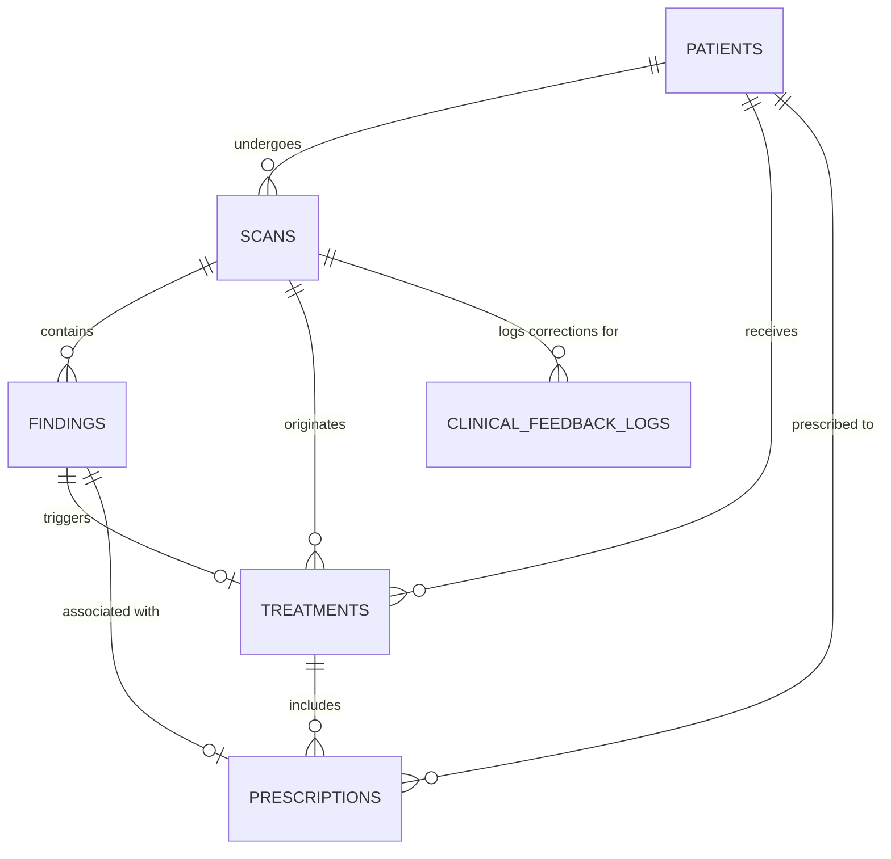

# DentalAI — Database Specification & Schema Guide

This document is the single source of truth for the Supabase PostgreSQL database schema. Any developer altering the database must consult and update this document.

---

## 1. Entity Relationship Diagram (ERD)

---

## 2. Table Dictionaries

### 2.1 `patients`
Stores longitudinal clinical and demographic data necessary for patient safety checks.

| Column | Type | Constraints | Description |
| :--- | :--- | :--- | :--- |
| `id` | `UUID` | `PRIMARY KEY, DEFAULT gen_random_uuid()` | Unique patient identifier |
| `dentist_id` | `UUID` | `REFERENCES auth.users(id)` | Treating clinician |
| `first_name` | `VARCHAR(100)` | `NOT NULL` | Patient given name |
| `last_name` | `VARCHAR(100)` | `NOT NULL` | Patient family name |
| `date_of_birth` | `DATE` | `NOT NULL` | Used for age & pediatric calculations |
| `gender` | `VARCHAR(20)` | `CHECK IN ('male', 'female', 'other')` | Patient gender |
| `weight_kg` | `NUMERIC(5,2)` | `CHECK (weight_kg > 0)` | Vital for pediatric drug calculations |
| `allergies` | `TEXT[]` | `DEFAULT '{}'` | Array of drug allergies (e.g. `{'penicillin'}`) |
| `current_medications`| `TEXT[]` | `DEFAULT '{}'` | Active medications (e.g. `{'warfarin'}`) |
| `medical_conditions`| `TEXT[]` | `DEFAULT '{}'` | Pre-existing conditions (e.g. `{'cardiac_risk'}`) |
| `created_at` | `TIMESTAMPTZ` | `DEFAULT NOW()` | Record creation timestamp |
| `updated_at` | `TIMESTAMPTZ` | `DEFAULT NOW()` | Auto-updated via trigger |

### 2.2 `scans`
Stores panoramic radiographs and the raw AI detection outputs.

| Column | Type | Constraints | Description |
| :--- | :--- | :--- | :--- |
| `id` | `UUID` | `PRIMARY KEY, DEFAULT gen_random_uuid()` | Unique scan identifier |
| `patient_id` | `UUID` | `REFERENCES patients(id) ON DELETE CASCADE`| Associated patient |
| `image_url` | `TEXT` | `NOT NULL` | Public/signed URL from Supabase Storage |
| `storage_path` | `TEXT` | Nullable | Path within the `xray-scans` bucket |
| `status` | `VARCHAR(30)` | `CHECK IN ('uploaded','processing','analyzed','reviewed','failed')` | Ingestion & review lifecycle |
| `raw_ml_output` | `JSONB` | `DEFAULT '{}'` | Exact JSON returned by `dentex_week3` |
| `ai_report` | `TEXT` | Nullable | Textual findings report generated by model |
| `image_width` | `INT` | Nullable | Original pixel width |
| `image_height` | `INT` | Nullable | Original pixel height |
| `created_at` | `TIMESTAMPTZ` | `DEFAULT NOW()` | Upload timestamp |
| `updated_at` | `TIMESTAMPTZ` | `DEFAULT NOW()` | Auto-updated via trigger |

### 2.3 `findings`
Individual detected pathologies mapped to specific teeth.

| Column | Type | Constraints | Description |
| :--- | :--- | :--- | :--- |
| `id` | `UUID` | `PRIMARY KEY, DEFAULT gen_random_uuid()` | Detection ID |
| `scan_id` | `UUID` | `REFERENCES scans(id) ON DELETE CASCADE` | Parent scan |
| `quadrant` | `INT` | `CHECK (1 <= quadrant <= 4)` | Quadrant index (1=UR, 2=UL, 3=LL, 4=LR) |
| `tooth_id` | `INT` | `CHECK (1 <= tooth_id <= 8)` | Tooth position from midline (1=incisor .. 8=wisdom) |
| `tooth_fdi` | `VARCHAR(10)` | `NOT NULL` | FDI notation (e.g., `'18'`, `'27'`, `'36'`, `'48'`) |
| `disease` | `VARCHAR(50)` | `NOT NULL` | `'Caries'`, `'Deep Caries'`, `'Periapical Lesion'`, `'Impacted'` |
| `disease_confidence` | `REAL`| `0 <= val <= 1` | Model classification confidence |
| `box` | `JSONB` | `NOT NULL` | Bounding box `[x1, y1, x2, y2]` in pixel coordinates |
| `review_status`| `VARCHAR(20)` | `CHECK IN ('pending','confirmed','rejected','modified')` | Dentist decision in Step 3 |
| `confirmed_disease`| `VARCHAR(50)` | Nullable | Dentist-corrected disease label |
| `reviewed_at` | `TIMESTAMPTZ` | Nullable | Time review was performed |

### 2.4 `treatments`
Clinical actions proposed based on confirmed findings.

| Column | Type | Constraints | Description |
| :--- | :--- | :--- | :--- |
| `id` | `UUID` | `PRIMARY KEY, DEFAULT gen_random_uuid()` | Treatment ID |
| `finding_id` | `UUID` | `REFERENCES findings(id) ON DELETE SET NULL` | Linked finding |
| `treatment_category`| `VARCHAR(50)`| `CHECK IN ('restorative', 'endodontic', 'surgical_extraction', 'periodontal', 'preventive', 'monitoring')` | Broad clinical category |
| `description` | `TEXT` | `NOT NULL` | Treatment summary |
| `status` | `VARCHAR(20)` | `CHECK IN ('proposed','confirmed','modified','in_progress','completed','cancelled')` | Status |
| `requires_prescription`| `BOOLEAN` | `DEFAULT FALSE` | True if medication is indicated |

### 2.5 `prescriptions`
Pharmacological orders cross-checked against patient history.

| Column | Type | Constraints | Description |
| :--- | :--- | :--- | :--- |
| `id` | `UUID` | `PRIMARY KEY, DEFAULT gen_random_uuid()` | Prescription ID |
| `treatment_id` | `UUID` | `REFERENCES treatments(id) ON DELETE CASCADE`| Parent treatment |
| `drug_name` | `VARCHAR(100)`| `NOT NULL` | e.g. `'Amoxicillin'`, `'Clindamycin'` |
| `dosage` | `VARCHAR(100)`| `NOT NULL` | e.g. `'500 mg'`, `'2 g'` |
| `frequency` | `VARCHAR(100)`| `NOT NULL` | e.g. `'every 8 hours'`, `'single dose'` |
| `duration` | `VARCHAR(100)`| `NOT NULL` | e.g. `'3-7 days'`, `'30-60 min pre-procedure'` |
| `indication_type`| `VARCHAR(50)`| `CHECK IN ('active_infection', 'pre_procedure_prophylaxis', 'pain_management')` | Clinical rationale |
| `contraindication_status` | `VARCHAR(20)`| `CHECK IN ('clear', 'warning', 'contraindicated')` | Safety engine result |
| `contraindication_warnings` | `JSONB` | `DEFAULT '[]'` | List of detailed warning objects |
| `dentist_status`| `VARCHAR(20)` | `CHECK IN ('proposed', 'accepted', 'modified', 'rejected')` | Final dentist choice |
| `dentist_override_reason` | `TEXT` | Nullable | Reason if dentist accepts a flagged warning |

### 2.6 `clinical_feedback_logs`
Immutable audit log recording discrepancies between AI predictions and dentist corrections.

| Column | Type | Constraints | Description |
| :--- | :--- | :--- | :--- |
| `id` | `UUID` | `PRIMARY KEY, DEFAULT gen_random_uuid()` | Log entry ID |
| `scan_id` | `UUID` | `REFERENCES scans(id) ON DELETE CASCADE` | Associated scan |
| `stage` | `VARCHAR(50)` | `CHECK IN ('finding_detection', 'treatment_recommendation', 'prescription_dosing')` | Stage of modification |
| `ai_original_data` | `JSONB` | `NOT NULL` | Snapshot of original model proposal |
| `dentist_corrected_data` | `JSONB` | `NOT NULL` | Snapshot of final dentist confirmation |
| `correction_type` | `VARCHAR(50)` | `CHECK IN ('false_positive', 'false_negative', 'misclassification', 'drug_override', 'dosage_adjusted', 'custom_note')` | Classification of discrepancy |
| `created_at` | `TIMESTAMPTZ` | `DEFAULT NOW()` | Timestamp of feedback capture |

---

## 3. How Teammates Should Alter the Schema in the Future

When adding new tables, modifying columns, or altering constraints:

1. **Never make untracked edits in Supabase UI:**
   Always write SQL migration files in `supabase/migrations/` (e.g. `supabase/migrations/20261011_add_column_x.sql`).
2. **Update this document (`DATABASE_SPEC.md`):**
   Update the corresponding table dictionary and ERD immediately.
3. **Update TypeScript types / Pydantic models:**
   Ensure the backend domain schemas (`backend/app/domain/`) and frontend types reflect the change.
4. **Preserve RLS and Foreign Key Cascades:**
   Any new table that links to `patients` or `scans` must specify `ON DELETE CASCADE` or `ON DELETE SET NULL` explicitly.

